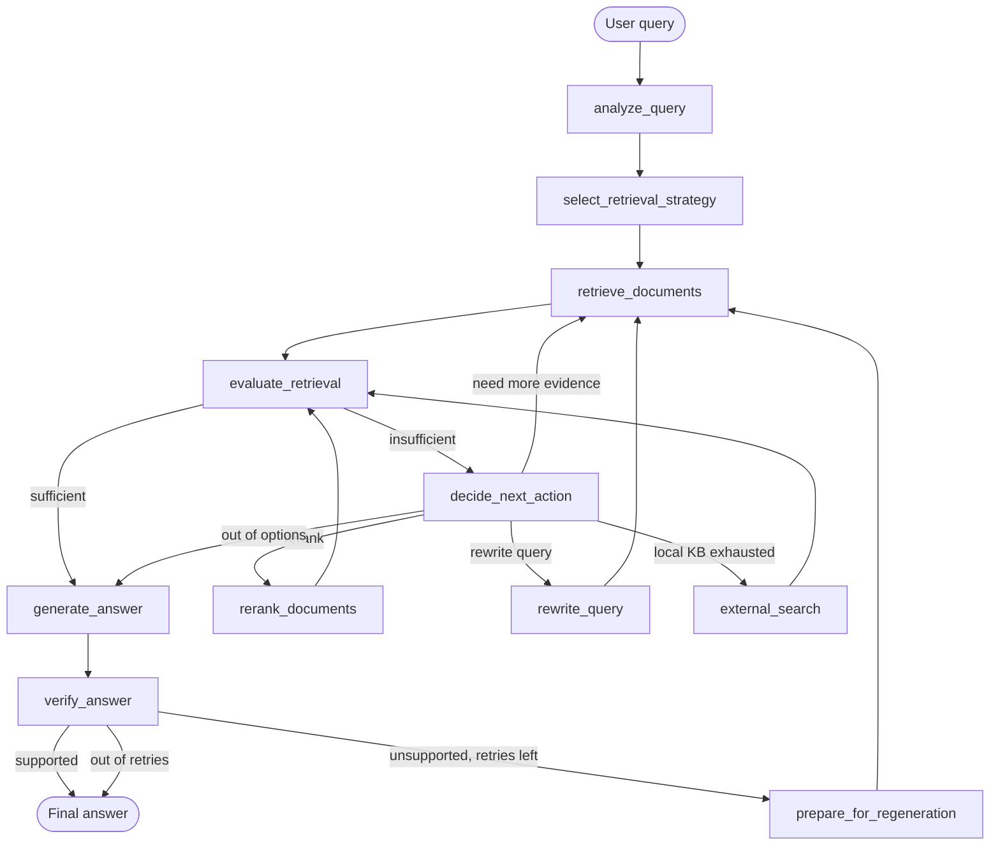

# AdaptiveRAG

**A self-correcting retrieval architecture for reliable and cost-efficient LLM systems.**

AdaptiveRAG is a multi-user, multi-conversation RAG application that does not blindly trust its
first retrieval attempt. Every query is routed through a **Query Analyzer**, retrieved with an
**adaptively-selected strategy**, scored by a **Context Evaluator**, and — when the evidence is
weak — repaired by a **Correction Controller** that chooses between reranking, query rewriting,
additional retrieval, or external search, before a final **Answer Verifier** checks the generated
answer against the evidence it was supposed to be based on.

```
User Query → Query Analyzer → Retrieval Strategy Selector → Retrieve
           → Context Evaluator ──sufficient──────────────────────┐
                    │ insufficient                                │
                    ▼                                              ▼
           Correction Controller                          Generate Answer
        (rerank / rewrite / retrieve more / web)                   │
                    │                                               ▼
                    └──────────► Re-evaluate            Answer Verifier
                                                                     │
                                                        supported ◄──┴──► unsupported
                                                            │                  │
                                                            ▼                  ▼
                                                      Final Answer   Retrieve more + regenerate
```

---

## 1. The problem with traditional RAG

A standard RAG pipeline is a straight line:

```
Query → Retriever → Top-K Documents → LLM → Answer
```

It has no way to notice when the retriever returned irrelevant, redundant, incomplete, or
badly-ranked context — it hands whatever came back straight to the LLM, which will confidently
answer anyway. That's a direct path to hallucination.

AdaptiveRAG's core principle: **evaluate retrieval before trusting it, and choose a
correction that matches *why* it fell short** — a query that's ambiguous needs rewriting; a
retrieval that found the right documents but ranked them poorly needs reranking, not a new
search; a retrieval that's relevant but incomplete needs *more* evidence, not different evidence.

## 2. Architecture

### 2.1 The adaptive workflow (LangGraph)

The whole decision process — analysis, retrieval, evaluation, correction, generation,
verification — is an explicit [LangGraph](https://github.com/langchain-ai/langgraph)
`StateGraph`, not nested `if/else` blocks. Every box below is a real graph node
(`graph/nodes.py`); every arrow is a real edge or conditional edge (`graph/edges.py`,
`graph/workflow.py`):



Why LangGraph specifically: the workflow is genuinely cyclic (retrieval can loop through
correction and back to evaluation several times) and needs durable, resumable state — a plain
LangChain chain models neither well. `StateGraph` gives explicit nodes/conditional edges (so
each decision is independently testable and independently visible in LangSmith), and its
Postgres checkpointer (`langgraph-checkpoint-postgres`) gives conversation-level persistence for
free.

### 2.2 The LangGraph state (`graph/state.py`)

The state goes beyond the minimal `query/context/answer/iteration` sketch you'd need for a
bare-bones version of this, because the whole point of the project is *explainable* adaptive
decision-making:

- **`original_query` vs `current_query`** are kept separate, so a query rewrite never silently
  overwrites the user's actual question (verification and the UI always show the original).
- **`retrieval_history` / `evaluation_history` / `correction_history`** are LangGraph reducer
  lists (`Annotated[list[...], operator.add]`) — every node just returns its own new event and
  LangGraph appends it. This is what powers the "🔍 Retrieval Analysis" debug panel and gives the
  Correction Controller the `actions_already_tried` it needs to avoid repeating a failing action.
- **`llm_call_count` / `retrieval_call_count` / `total_tokens_estimate`** are reducer-accumulated
  counters, satisfying the project's cost/latency-tracking goal without any node needing to know
  the running total.
- **`node_trace`** is a cheap, human-readable path trace independent of LangSmith, useful when
  tracing is off.

### 2.3 The Correction Controller (`retrieval/controller.py`)

This is the project's central contribution. Given the Context Evaluator's structured scores, the
current retrieval strategy, and which corrections have already been tried this turn, it picks the
next action via an **explicit, inspectable rule policy** — not one more vague LLM call:

| Signal | Action |
|---|---|
| Relevant but poorly ordered/weak evidence | **Rerank** existing candidates (cheapest fix) |
| Relevant but incomplete | **Additional retrieval**, broadening to hybrid if not already |
| Low relevance across the board | **Rewrite the query** (the query itself is likely the problem) |
| Local KB still insufficient, web search enabled | **External search** |
| Max iterations reached / options exhausted | **Give up** — say so, don't hallucinate |

Every decision comes with a plain-English `reason` string that ends up in both LangSmith and the
UI's debug panel — nothing about *why* the system did what it did is a black box.

### 2.4 Retrieval strategies (`retrieval/`)

- **Vector** — dense cosine-similarity search via `langchain-postgres`' `PGVectorStore` over
  pgvector, filtered by `chat_id`/`user_id` at the SQL level.
- **Keyword** — PostgreSQL full-text search (`ts_rank` over a generated `tsvector` column),
  used for exact/technical lookups.
- **Hybrid** — Reciprocal Rank Fusion of the two above. RRF is used instead of a naive score
  average because cosine similarity and `ts_rank` live on incomparable scales; RRF only needs
  rank order, so it's robust regardless of either score's distribution.
- **External (web)** — optional, Tavily-backed, fully disable-able (`ENABLE_WEB_SEARCH=false`
  by default) — a last-resort correction, never a default strategy.

## 3. Why PostgreSQL + pgvector

One database, not two. Users, chats, messages, documents, vector embeddings, *and* LangGraph's
own checkpoint state all live in the same PostgreSQL instance
(`database/migrations/001_init_schema.sql`), queried through `langchain-postgres`'
`PGEngine`/`PGVectorStore` (the current, non-deprecated integration — not the older
`langchain_community` pgvector wrapper) plus `langgraph-checkpoint-postgres` for graph state. That
means one backup story, one connection story, and — most importantly — **chat-scoped retrieval
isolation is enforced by the same SQL `WHERE chat_id = ...` clause as everything else**, not by
some UI-layer convention that could be bypassed.

## 4. Why LangSmith

Every node in the graph above becomes a real span in LangSmith when `LANGSMITH_TRACING=true`
(`observability/langsmith.py`), tagged with `user_id`, `chat_id`, `query_id`, retrieval strategy,
iteration number, evaluation score, and correction action — exactly the metadata you need to
debug *why* a particular answer took the path it took, days after the fact. Tracing is entirely
env-var driven and fails soft: if LangSmith is unreachable or misconfigured, the app keeps working
with tracing simply off (never a hard dependency — see §13).

## 5. Authentication & authorization

- Passwords are hashed with **Argon2id** (`auth/password.py`) — never stored, logged, or traced.
- Login timing doesn't reveal whether an email exists: a dummy hash is verified even for unknown
  emails, and both failure paths return the identical message (see `test_auth.py`).
- **Every chat/document read or write re-verifies ownership against the authenticated user's id**
  before touching anything — a `chat_id` arriving from the frontend is never trusted on its own
  (`ChatRepository.get_owned_by_user`, `ChatService.get_chat`, and every service method that takes
  a `chat_id` calls it first). See `tests/test_chat_isolation.py`.
- `st.session_state` holds only *which user is logged in* and *which chat is open* — never chat
  content, messages, or documents, all of which are reloaded from PostgreSQL on every rerun
  (`auth/session.py`). Kill the Streamlit process and log back in: nothing is lost.

## 6. Chat / document isolation

Every chat has its own document scope. Uploading a document during chat creation (or later, via
"➕ Add documents to this chat") stores chunks tagged with `user_id`, `chat_id`, and `document_id`
as real, indexed, typed Postgres columns (not just JSON metadata) — and **every retrieval query,
across all three strategies, filters by `chat_id` at the database layer**
(`retrieval/vector_retriever.py`, `retrieval/keyword_retriever.py`). `tests/test_chat_isolation.py`
verifies directly that a query scoped to Chat A returns nothing from Chat B, even when Chat B
contains text that would otherwise match.

Deleting a chat (`ChatService.delete_chat`) removes its messages, documents (DB rows *and* files
on disk), vector chunks (via `ON DELETE CASCADE` from the `chats` row), and its LangGraph
checkpoint thread (`PostgresSaver.delete_thread`) — nothing is left orphaned.

## 7. Cost / latency awareness

The Context Evaluator's thresholds (`SUFFICIENT_THRESHOLD` / `PARTIAL_THRESHOLD`) mean a strong
first retrieval (e.g. relevance 0.92) goes straight to generation — no wasted correction round
trip. Structured-output nodes (classification/scoring) default to a cheaper/faster model
(`FAST_MODEL`) than answer generation (`CHAT_MODEL`), and the Correction Controller's routing
itself costs zero extra LLM calls, since it's a rule policy over scores the evaluator already
produced. `graph/state.py`'s counters and `evaluation/benchmark.py` make this measurable rather
than assumed — see §11.

---

## 8. Project structure

```
adaptive-rag/
├── app.py                    # Streamlit entrypoint
├── config/                   # Settings (.env-driven) + constants/enums
├── auth/                     # Password hashing, signup/login, session
├── database/                 # Connection pool, models, repositories, SQL migrations
├── ingestion/                # Loaders (pdf/txt/docx/md), cleaning, chunking, embeddings, pipeline
├── retrieval/                # vector / keyword / hybrid / web retrievers, reranker, controller
├── evaluation/                # Structured-output schemas, retrieval/answer evaluators, benchmark
├── graph/                    # LangGraph state, nodes, edges, workflow assembly
├── generation/                # Prompts + answer/rewrite/chat-name generation
├── services/                 # chat_service, document_service, message_service (the app's real API)
├── ui/                       # Streamlit pages/components
├── observability/             # LangSmith wiring
├── scripts/                   # migrate.py, run_benchmark.py
├── tests/                     # pytest suite (see §10)
├── docker-compose.yml         # Postgres + pgvector
├── Dockerfile                 # optional: containerize the app itself
├── requirements.txt
└── .env.example
```

---

## 9. Getting started

### 9.1 Prerequisites

- Python 3.11+
- Docker (for PostgreSQL + pgvector), or a PostgreSQL 16+ instance with the `vector` extension
  installable yourself
- An OpenAI API key (or adapt `ingestion/embeddings.py` / `evaluation/schemas.py` for another
  provider — see §9.5)

### 9.2 Install

```bash
python3 -m venv .venv && source .venv/bin/activate
pip install -r requirements.txt
cp .env.example .env
# edit .env: set OPENAI_API_KEY at minimum
```

### 9.3 Database

```bash
docker-compose up -d          # starts PostgreSQL 16 + pgvector on localhost:5432
python -m scripts.migrate     # creates the app schema AND the LangGraph checkpoint tables
```

`scripts/migrate.py` is idempotent — safe to re-run. It applies every `*.sql` file under
`database/migrations/` in order, then calls `PostgresSaver.setup()`.

### 9.4 Run

```bash
streamlit run app.py
```

Open the printed local URL, sign up, create a chat, upload a PDF/TXT/DOCX, and ask a question.

### 9.5 Using a different LLM provider

Two factory functions are the only places that construct model clients:
`ingestion/embeddings.py:get_embeddings()` and `evaluation/schemas.py:_base_llm()`. Add a branch
for your provider in each (both are keyed off `LLM_PROVIDER` in `.env`) — nothing else in the
codebase imports a provider SDK directly.

---

## 10. Testing

```bash
# tests run against a SEPARATE database (never your dev DB) — create it once:
docker exec -it adaptive_rag_postgres psql -U adaptive_rag -c "CREATE DATABASE adaptive_rag_test;"
pytest tests/ -v
```

`tests/conftest.py` points every test at `adaptive_rag_test` (refusing to run at all if
`DATABASE_URL` doesn't contain `_test`), applies migrations once per session, and truncates every
app table before each test for isolation. What's covered:

| File | Covers |
|---|---|
| `test_auth.py` | signup, duplicate email, login, wrong password, timing-safe failure messages |
| `test_chat_isolation.py` | cross-user chat/document access denied; **Chat A cannot retrieve Chat B's documents**, even with matching text; untrusted `chat_id` from the frontend is never honored; chat deletion leaves no orphaned rows |
| `test_ingestion.py` | PDF/TXT/DOCX loading (including a corrupted-PDF failure path), cleaning, chunking, page-number/metadata preservation |
| `test_retrieval.py` | Correction Controller decision policy (rerank vs. rewrite vs. more-retrieval vs. web vs. give-up, and never repeating a failed action); hybrid RRF fusion ordering |
| `test_graph.py` | Full compiled LangGraph, LLM/retriever calls mocked at the boundary: sufficient retrieval → direct generation; partial → correction loop → success; poor evidence → graceful give-up with **no hallucinated generation call**; low relevance → query rewrite (never touching `original_query`) |
| `test_persistence.py` | chats/messages/LangGraph checkpoint state all survive a simulated process restart (fresh connection pool / fresh checkpointer instance) |

All 50 tests were run against a real, locally built PostgreSQL 16 + pgvector 0.8.0 instance while
building this project — this isn't a suite that only works in theory. LLM-dependent tests mock at
the exact boundary `graph/nodes.py` imports from, so the whole suite needs no `OPENAI_API_KEY` and
no network access except to your own database.

---

## 11. Evaluation / benchmarking (`evaluation/benchmark.py`)

Compares a naive baseline (`query → vector_search(k) → generate`) against the full AdaptiveRAG
workflow, **on the same question, scored by the same LLM judges** (so the comparison isn't
AdaptiveRAG grading its own homework more leniently):

```bash
python -m scripts.run_benchmark --chat-id <uuid> --user-id <uuid> \
    --questions "What is the main contribution of this paper?" "How do the two methods compare?"
```

Reports, per pipeline: average relevance/completeness/faithfulness, % of answers verified as
supported, average latency, and average retrieval/LLM call counts — i.e. both sides of the
reliability/cost tradeoff this project is about.

---

## 12. Example workflow

1. **Sign up / log in** — Argon2-hashed credentials in `users`.
2. **+ New Chat** — upload `transformers.pdf`, `attention.pdf`; a suggested title
   ("Transformers & Attention") is generated from the filenames; documents are chunked, embedded,
   and stored tagged with the new `chat_id`.
3. **Ask**: *"How does the attention mechanism differ from RNN-based approaches?"*
   - Query Analyzer: `comparative`, `requires_multiple_sources=true` → hybrid retrieval selected.
   - First hybrid retrieval scores `overall=0.58` → **partial**.
   - Correction Controller: relevance is fine but completeness is low → **additional retrieval**.
   - Second retrieval (broadened) scores `overall=0.83` → **sufficient**.
   - Answer generated with inline `[1][2]` citations; Verifier confirms `faithfulness=0.94`,
     `supported=true`.
   - UI shows the answer, its sources with real page numbers, and a "🔍 Retrieval Analysis" panel
     showing exactly the path above.

---

## 13. What this deliberately does NOT do

Per the project's own ground rules: no Streamlit-session-state-as-database, no plaintext
passwords, no cross-chat document leakage, no hardcoded secrets, no uncontrolled recursive
retrieval loop (hard-capped by `MAX_RETRIEVAL_ITERATIONS`), no fabricated citations, no
auth secrets sent to LangSmith, and no "RAG plus one extra LLM call" masquerading as an adaptive
architecture — the Correction Controller's routing is a real, tested, explainable policy engine.
LangSmith failure specifically never blocks the core app (§4); PostgreSQL/embedding/LLM failures
are caught at each node boundary and degrade to an honest "insufficient evidence" answer rather
than a crash or a hallucination (see the `try/except` blocks in `evaluation/retrieval_evaluator.py`,
`evaluation/answer_evaluator.py`, `retrieval/reranker.py`, and `retrieval/web_retriever.py`).

## 14. Future improvements

- Streaming token-by-token answer generation in the UI.
- A learned reranker (cross-encoder) as a faster alternative to the current LLM-judge reranker.
- Per-user/per-chat cost dashboards built from the counters already tracked in `graph/state.py`.
- Table/image-aware chunking for documents with significant non-text content.
- Multi-tenant rate limiting at the service layer.
